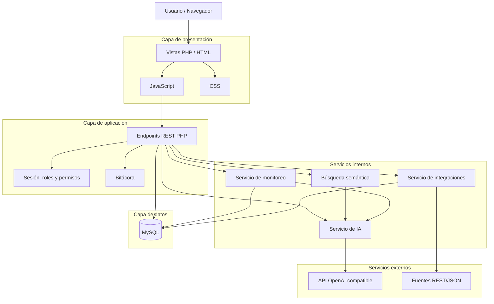
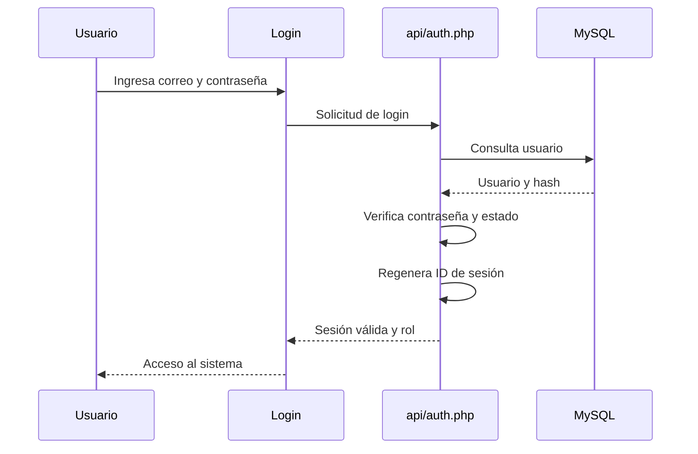
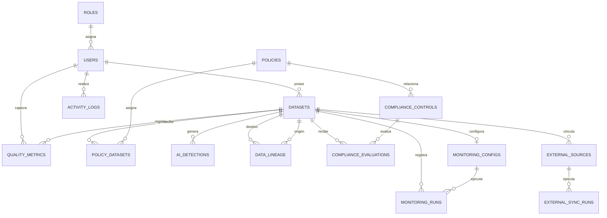
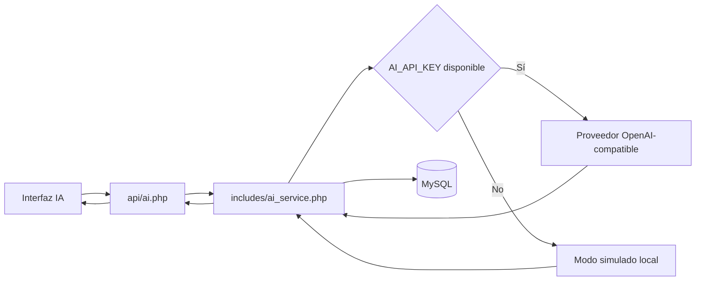
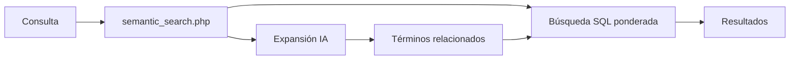
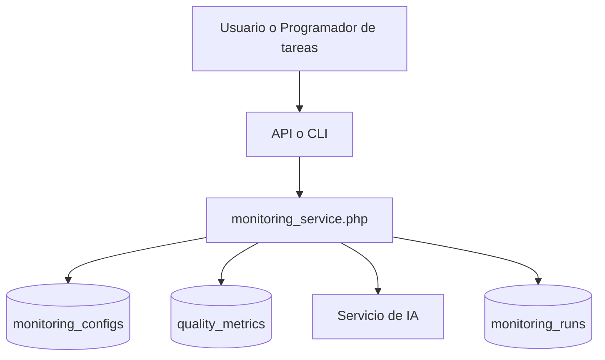
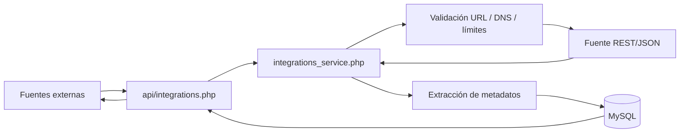
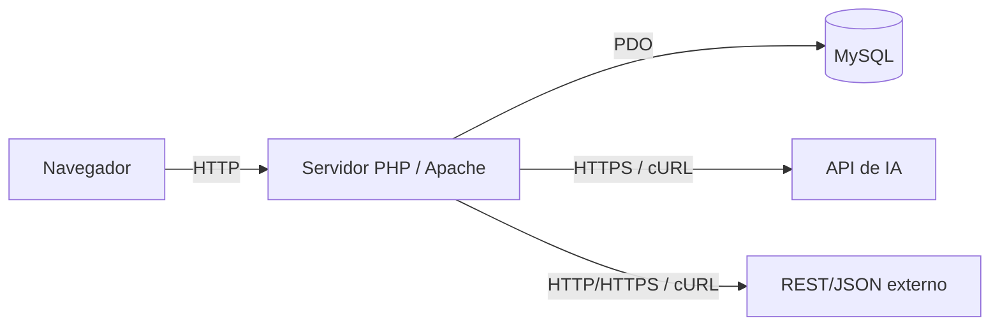

# DOCUMENTO DE ARQUITECTURA
## Plataforma de Gobierno de Datos con Inteligencia Artificial

**Proyecto:** Plataforma de Gobierno de Datos con Inteligencia Artificial  
**Empresa:** Develop Talent & Technology  
**Tipo de documento:** Documento de arquitectura  
**Versión:** 1.0  
**Estado:** Final  
**Arquitectura implementada:** Aplicación web cliente-servidor con PHP, MySQL, JavaScript y API REST JSON

---

## 1. Introducción

El presente documento describe la arquitectura técnica implementada en la Plataforma de Gobierno de Datos con Inteligencia Artificial. Su propósito es mostrar cómo se organizan los componentes del sistema, cómo se comunican entre sí, dónde se almacena la información y de qué manera se integran los servicios de Inteligencia Artificial y las fuentes externas.

La solución fue desarrollada como una aplicación web modular. La interfaz se encuentra separada de los endpoints de la API, mientras que la lógica reutilizable se concentra en servicios y funciones compartidas. La persistencia se realiza en MySQL mediante PDO y consultas preparadas.

---

## 2. Objetivo de la arquitectura

La arquitectura busca cumplir los siguientes objetivos:

- Separar la presentación, la lógica de negocio y el acceso a datos.
- Centralizar la autenticación y el control de permisos.
- Mantener una API JSON consistente para las operaciones del sistema.
- Facilitar la reutilización de funciones comunes.
- Integrar servicios externos sin exponer claves al navegador.
- Mantener trazabilidad de las acciones relevantes.
- Permitir que los módulos puedan evolucionar sin modificar toda la aplicación.
- Proteger la integridad de la información mediante reglas de aplicación y relaciones de base de datos.

---

## 3. Vista general de la arquitectura

La solución utiliza una arquitectura web cliente-servidor dividida en cuatro niveles lógicos:

1. **Presentación**
2. **API y lógica de aplicación**
3. **Servicios internos**
4. **Persistencia e integraciones externas**



---

## 4. Arquitectura por capas

### 4.1 Capa de presentación

Está formada principalmente por:

- `views/`
- `assets/css/`
- `assets/js/`

Las vistas PHP generan la estructura principal de cada pantalla y cargan los recursos de estilo y JavaScript. La interacción dinámica se realiza desde JavaScript mediante solicitudes a los endpoints de la API.

Responsabilidades principales:

- Mostrar formularios, tablas, tarjetas, gráficos y mensajes.
- Capturar acciones del usuario.
- Consumir la API.
- Mostrar estados de carga, éxito y error.
- Adaptarse a escritorio y dispositivos móviles.
- Aplicar accesibilidad básica en formularios y modales.

La capa de presentación no debe considerarse una barrera de seguridad. Los permisos reales se validan también en el servidor.

---

### 4.2 Capa de aplicación y API

Está formada por los archivos ubicados en:

`api/`

Endpoints existentes:

- `auth.php`
- `users.php`
- `datasets.php`
- `quality.php`
- `policies.php`
- `compliance.php`
- `lineage.php`
- `monitoring.php`
- `integrations.php`
- `ai.php`
- `reports.php`

Los endpoints reciben solicitudes de la interfaz o de herramientas como Postman y responden principalmente en formato JSON.

La convención utilizada es:

`api/<modulo>.php?action=<accion>`

Ejemplo conceptual:

`api/datasets.php?action=list`

La respuesta estándar sigue una estructura semejante a:

```json
{
  "success": true,
  "data": {},
  "message": ""
}
```

Responsabilidades principales:

- Validar sesión.
- Validar rol.
- Validar propiedad de recursos cuando corresponde.
- Procesar operaciones CRUD.
- Ejecutar reglas de negocio.
- Consultar y modificar MySQL.
- Llamar a servicios internos.
- Registrar acciones relevantes en bitácora.
- Devolver respuestas JSON controladas.

---

### 4.3 Servicios internos

Los servicios reutilizables se encuentran principalmente dentro de:

`includes/`

Componentes principales:

| Archivo | Responsabilidad |
|---|---|
| `functions.php` | Sesiones, roles, respuesta JSON, escapado, bitácora y funciones comunes |
| `ai_service.php` | Comunicación con proveedor de IA y modo simulado |
| `semantic_search.php` | Expansión y procesamiento de búsqueda semántica |
| `monitoring_service.php` | Lógica reutilizable de monitoreo |
| `integrations_service.php` | Consumo seguro de fuentes REST/JSON |

La separación de estos servicios permite que una misma lógica pueda ser utilizada por distintos endpoints o por procesos como el monitor ejecutado desde CLI.

---

### 4.4 Capa de datos

La persistencia utiliza:

- MySQL 8.
- PDO.
- Consultas preparadas.
- Charset `utf8mb4`.

La conexión se centraliza en:

`config/database.php`

La configuración se obtiene desde:

`config/app.php`

Los valores sensibles se cargan desde un archivo `.env` local.

La aplicación utiliza una única función de conexión PDO reutilizable. La emulación de consultas preparadas se mantiene desactivada:

`PDO::ATTR_EMULATE_PREPARES = false`

---

## 5. Estructura física del proyecto

```text
gobierno-datos-ia/
├── api/
│   ├── ai.php
│   ├── auth.php
│   ├── compliance.php
│   ├── datasets.php
│   ├── integrations.php
│   ├── lineage.php
│   ├── monitoring.php
│   ├── policies.php
│   ├── quality.php
│   ├── reports.php
│   └── users.php
│
├── assets/
│   ├── css/
│   │   └── style.css
│   └── js/
│       ├── ai.js
│       ├── app.js
│       ├── compliance.js
│       ├── dashboard.js
│       ├── datasets.js
│       ├── dataset_detail.js
│       ├── integrations.js
│       ├── lineage.js
│       ├── monitoring.js
│       ├── policies.js
│       ├── quality.js
│       ├── reports.js
│       └── users.js
│
├── cli/
│   ├── monitor.php
│   └── monitor.bat
│
├── config/
│   ├── app.php
│   └── database.php
│
├── includes/
│   ├── ai_service.php
│   ├── functions.php
│   ├── integrations_service.php
│   ├── monitoring_service.php
│   └── semantic_search.php
│
├── postman/
│   ├── GobiernoDatosIA.postman_collection.json
│   └── GobiernoDatosIA.postman_environment.json
│
├── sql/
│   ├── database.sql
│   ├── migration_compliance.sql
│   ├── migration_integrations.sql
│   ├── migration_lineage.sql
│   ├── migration_monitoring.sql
│   └── seed.sql
│
├── views/
│   ├── includes/
│   │   ├── footer.php
│   │   └── header.php
│   ├── ai.php
│   ├── compliance.php
│   ├── dashboard.php
│   ├── datasets.php
│   ├── dataset_detail.php
│   ├── integrations.php
│   ├── lineage.php
│   ├── login.php
│   ├── monitoring.php
│   ├── policies.php
│   ├── quality.php
│   ├── reports.php
│   └── users.php
│
├── .env.example
├── .gitignore
├── index.php
├── iniciar.bat
├── jsconfig.json
└── README.md
```

El archivo `.env` es local y no forma parte de la entrega final.

---

## 6. Arquitectura de autenticación y autorización

El sistema utiliza sesiones de PHP.

### 6.1 Inicio de sesión

Flujo general:



Al iniciar sesión se almacenan datos básicos como:

- ID.
- Nombre.
- Correo.
- Rol.

La cookie de sesión utiliza `HttpOnly` y `SameSite=Lax`.

### 6.2 Autorización

Las funciones centrales de autorización son:

- `requireAuth()`
- `requireRole()`
- `currentUser()`
- `currentRole()`

Los módulos que manejan propiedad de recursos realizan además validaciones sobre el usuario responsable.

La administración de usuarios incluye dos reglas adicionales:

- Un administrador no puede desactivar su propia cuenta.
- Debe quedar al menos un administrador activo.

---

## 7. Arquitectura de base de datos

El esquema principal contiene 15 tablas:

1. `roles`
2. `users`
3. `datasets`
4. `quality_metrics`
5. `policies`
6. `policy_datasets`
7. `ai_detections`
8. `data_lineage`
9. `activity_logs`
10. `compliance_controls`
11. `compliance_evaluations`
12. `monitoring_configs`
13. `monitoring_runs`
14. `external_sources`
15. `external_sync_runs`

### 7.1 Relaciones principales



Las relaciones principales utilizan llaves foráneas. En distintos casos se utilizan acciones como `ON DELETE CASCADE` o `ON DELETE SET NULL` para conservar la integridad según la naturaleza del registro.

---

## 8. Arquitectura del módulo de Inteligencia Artificial

El frontend nunca se comunica directamente con el proveedor de IA.

Flujo:



Variables utilizadas:

- `AI_API_KEY`
- `AI_MODEL`
- `AI_BASE_URL`

Funciones principales:

- `classify`
- `anomalies`
- `summary`
- `suggest`

La clave de IA permanece del lado del servidor.

---

## 9. Arquitectura de búsqueda semántica

La búsqueda semántica se encuentra implementada en:

`includes/semantic_search.php`

No utiliza embeddings ni una base vectorial.

Flujo general:

1. El usuario escribe una consulta.
2. La API recibe el texto.
3. El servicio puede solicitar a la IA términos equivalentes o relacionados.
4. La aplicación construye la búsqueda sobre los campos del catálogo.
5. Los resultados reciben una relevancia ponderada.
6. Si la IA no está disponible, se mantiene la búsqueda literal.



---

## 10. Arquitectura de calidad de datos

Las mediciones de calidad se almacenan en:

`quality_metrics`

Las cinco dimensiones son:

- Completitud.
- Exactitud.
- Consistencia.
- Vigencia.
- Unicidad.

El score se calcula mediante:

`score = completitud·0.20 + exactitud·0.25 + consistencia·0.20 + vigencia·0.15 + unicidad·0.20`

El historial de calidad se utiliza también como entrada para:

- Alertas.
- Reportes.
- IA.
- Monitoreo.

El monitoreo no genera mediciones nuevas de forma ficticia; revalida la última medición existente.

---

## 11. Arquitectura de cumplimiento

El módulo utiliza principalmente:

- `compliance_controls`
- `compliance_evaluations`

Un control puede relacionarse con una política. Posteriormente se registra una evaluación por dataset.

Estados soportados:

- `cumple`
- `no_cumple`
- `pendiente`
- `no_aplica`

Las evaluaciones pueden conservar:

- Observaciones.
- Evidencia.
- Evaluador.
- Fecha.

La información representa seguimiento interno y no una determinación legal automatizada.

---

## 12. Arquitectura de linaje

La tabla:

`data_lineage`

almacena relaciones entre:

- Dataset de origen.
- Dataset de destino.
- Tipo de relación.
- Descripción.
- Usuario creador.
- Fecha.

Los tipos disponibles incluyen:

- `derivado_de`
- `alimenta`
- `integra`
- `transforma`
- `copia`
- `version_de`

La aplicación valida que el mismo dataset no pueda ser simultáneamente origen y destino de una relación.

---

## 13. Arquitectura de monitoreo

Componentes:

- `api/monitoring.php`
- `includes/monitoring_service.php`
- `cli/monitor.php`
- `cli/monitor.bat`
- `monitoring_configs`
- `monitoring_runs`

Flujo:



La configuración conserva, entre otros datos:

- Dataset.
- Frecuencia.
- Estado activo.
- Estado de ejecución.
- Próxima ejecución.
- Último score.
- Última ejecución.

El campo de ejecución permite impedir que una misma configuración se procese simultáneamente.

---

## 14. Arquitectura de integraciones externas

Componentes:

- `api/integrations.php`
- `includes/integrations_service.php`
- `external_sources`
- `external_sync_runs`

Las fuentes implementadas son REST/JSON mediante GET.

Flujo:



Controles aplicados:

- HTTP/HTTPS.
- Validación de host.
- Validación de resolución DNS.
- Bloqueo de destinos privados/locales en operación normal.
- Sin redirecciones.
- Timeout.
- Límite máximo de respuesta.
- Historial de pruebas y sincronizaciones.

La opción:

`INTEGRACION_PERMITIR_LOCALHOST=true`

se reserva únicamente para desarrollo o pruebas.

---

## 15. Arquitectura de auditoría

La tabla:

`activity_logs`

registra acciones relevantes.

Información principal:

- Usuario.
- Acción.
- Detalle.
- Dirección IP.
- Fecha.

La función central utilizada es:

`logActivity()`

El registro de auditoría se diseñó para no detener una operación principal si el guardado de la bitácora falla.

La visibilidad de actividad reciente depende del rol:

- Admin: actividad global.
- Steward: actividad de gobierno excluyendo eventos administrativos sensibles.
- Owner: actividad propia o relacionada con sus datasets.
- Analyst: actividad propia.

La bitácora completa se mantiene disponible solamente para Admin.

---

## 16. Configuración y variables de entorno

La configuración se carga desde:

`config/app.php`

Archivo utilizado localmente:

`.env`

Plantilla pública:

`.env.example`

Variables principales:

| Variable | Uso |
|---|---|
| `DB_HOST` | Host MySQL |
| `DB_PORT` | Puerto MySQL |
| `DB_NAME` | Base de datos |
| `DB_USER` | Usuario MySQL |
| `DB_PASS` | Contraseña MySQL |
| `APP_URL` | URL de la aplicación |
| `APP_DEBUG` | Modo de depuración |
| `AI_API_KEY` | Clave del proveedor de IA |
| `AI_MODEL` | Modelo seleccionado |
| `AI_BASE_URL` | URL base del proveedor |
| `INTEGRACION_TIMEOUT` | Timeout general de integración |
| `INTEGRACION_CONNECT_TIMEOUT` | Timeout de conexión |
| `INTEGRACION_MAX_BYTES` | Tamaño máximo de respuesta |
| `INTEGRACION_PERMITIR_LOCALHOST` | Permite destinos locales solo para pruebas |

`APP_KEY` se encuentra reservada en la configuración actual y no interviene en la autenticación ni en el cifrado de datos.

---

## 17. Seguridad arquitectónica

Las principales decisiones de seguridad son:

- Contraseñas con hash.
- Sesiones del lado del servidor.
- Regeneración del ID al iniciar sesión.
- Cookie `HttpOnly`.
- `SameSite=Lax`.
- Control de rol en backend.
- Comprobación de propiedad de recursos.
- PDO con consultas preparadas.
- Emulación de prepares desactivada.
- Escapado de HTML.
- Neutralización de fórmulas en exportaciones CSV.
- Variables sensibles fuera del repositorio.
- Cabecera `X-Content-Type-Options: nosniff`.
- Cabecera `X-Frame-Options: SAMEORIGIN`.
- Cabecera `Referrer-Policy: strict-origin-when-cross-origin`.
- Controles SSRF sobre integraciones.
- Límites de tamaño y tiempo en solicitudes externas.
- Protección para conservar al menos un administrador activo.

### 17.1 Consideración pendiente para producción

La arquitectura actual no incluye tokens anti-CSRF para endpoints que modifican información. Para una implementación productiva se recomienda incorporar una protección CSRF dedicada junto con HTTPS y políticas adicionales de endurecimiento.

---

## 18. Arquitectura de despliegue actual

El entorno de ejecución utilizado corresponde a un despliegue web local/académico.



La aplicación puede ejecutarse mediante:

```text
php -S 127.0.0.1:8000 -t .
```

o bajo un servidor como Apache en un entorno local.

---

## 19. Decisiones técnicas principales

| Decisión | Motivo |
|---|---|
| PHP sin framework | Mantener el proyecto dentro de las tecnologías utilizadas por el estudiante |
| MySQL + PDO | Persistencia relacional y consultas preparadas |
| JavaScript vanilla | Reducir dependencias adicionales |
| API REST JSON | Separar interacción del frontend y lógica de servidor |
| Sesiones PHP | Autenticación adecuada al alcance local de la solución |
| IA OpenAI-compatible | Permitir cambiar proveedor mediante configuración |
| Modo simulado | Permitir demostrar la IA sin una API externa |
| Búsqueda semántica híbrida | Añadir búsqueda por significado sin requerir infraestructura vectorial |
| CLI para monitoreo | Permitir automatización sin agregar un servicio permanente |
| REST/JSON GET para integraciones | Mantener una integración controlada y acorde con el alcance |
| `.env` | Mantener secretos fuera del código fuente |

---

## 20. Trazabilidad entre módulos y componentes

| Módulo | Vista | JavaScript | API | Servicio / tablas principales |
|---|---|---|---|---|
| Usuarios | `views/users.php` | `users.js` | `users.php` | `users`, `roles` |
| Datasets | `views/datasets.php` | `datasets.js` | `datasets.php` | `datasets`, `semantic_search.php` |
| Detalle | `views/dataset_detail.php` | `dataset_detail.js` | Varios endpoints | `datasets` y entidades relacionadas |
| Calidad | `views/quality.php` | `quality.js` | `quality.php` | `quality_metrics` |
| Políticas | `views/policies.php` | `policies.js` | `policies.php` | `policies`, `policy_datasets` |
| Cumplimiento | `views/compliance.php` | `compliance.js` | `compliance.php` | `compliance_controls`, `compliance_evaluations` |
| Linaje | `views/lineage.php` | `lineage.js` | `lineage.php` | `data_lineage` |
| IA | `views/ai.php` | `ai.js` | `ai.php` | `ai_service.php`, `ai_detections` |
| Monitoreo | `views/monitoring.php` | `monitoring.js` | `monitoring.php` | `monitoring_service.php`, `monitoring_configs`, `monitoring_runs` |
| Integraciones | `views/integrations.php` | `integrations.js` | `integrations.php` | `integrations_service.php`, `external_sources`, `external_sync_runs` |
| Dashboard | `views/dashboard.php` | `dashboard.js` | `reports.php` y otros | Datos agregados de varios módulos |
| Reportes | `views/reports.php` | `reports.js` | `reports.php` | `activity_logs`, calidad, IA |

---

## 21. Consideraciones de mantenimiento

Para mantener la arquitectura consistente se recomienda:

- Evitar colocar lógica sensible únicamente en JavaScript.
- Mantener la validación de permisos en los endpoints.
- Reutilizar los servicios existentes en lugar de duplicar lógica.
- Agregar cambios de estructura mediante migraciones cuando el sistema ya contenga información.
- No incluir `.env` en Git ni en entregas públicas.
- Mantener las nuevas integraciones sujetas a controles SSRF.
- Conservar respuestas JSON consistentes en los endpoints.
- Actualizar este documento cuando se incorporen nuevos módulos o se modifique el modelo de datos.

---

## 22. Conclusión

La Plataforma de Gobierno de Datos con Inteligencia Artificial utiliza una arquitectura web modular basada en PHP, MySQL y JavaScript. La separación entre vistas, endpoints, servicios internos y persistencia permite organizar las responsabilidades del sistema y mantener un flujo claro entre usuario, aplicación, base de datos y servicios externos.

La arquitectura implementada cubre catálogo, calidad, políticas, cumplimiento, linaje, búsqueda semántica, monitoreo, fuentes externas, Inteligencia Artificial, reportes y auditoría. Asimismo, incorpora control de acceso por roles, consultas preparadas, protección de secretos y controles específicos para integraciones externas.

Esta estructura proporciona una base adecuada para la entrega académica y permite que la solución pueda mantenerse o ampliarse posteriormente sin reemplazar su diseño principal.
